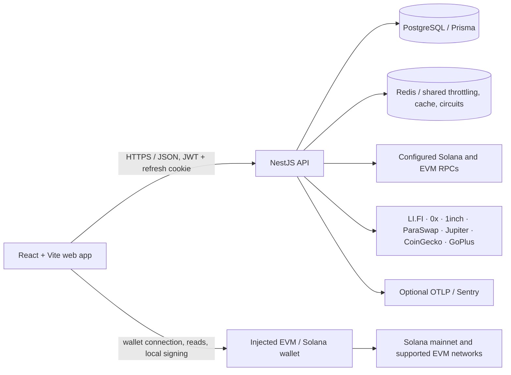

# Mega Gods Prompt NEXT

**Repository:** [SolanaRemix/next](https://github.com/SolanaRemix/next)  
**Version:** `1.0.0-rc.1`  
**License:** Apache-2.0

Mega Gods Prompt NEXT is a self-custody, multi-chain wallet dashboard with account roles, read-only portfolio and risk tools, wallet-approved transfers and swaps, and audited operator controls. This repository is a **release candidate**, not the First Stable Production Release. The production-readiness gaps and deployment constraints are listed below and in [`docs/OPERATIONS.md`](docs/OPERATIONS.md).

## Architecture



`apps/web` is the browser application, `apps/api` is the HTTP API and persistence layer, and `packages/types`, `packages/ui`, and `packages/config` provide shared types, React components, and theme tokens. Wallets retain private keys; the API stores accounts and refresh-token hashes, not wallet secrets. API responses, cookies, and wallet transactions follow the specific flows described in [`docs/SECURITY.md`](docs/SECURITY.md).

## Feature access by role

Roles are hierarchical: `Guest < Viewer < Trader < EnterpriseAdmin < SuperAdmin`. A higher role inherits routes guarded by lower roles. An account receives `Guest` on registration; privileged roles are assigned manually by a SuperAdmin or through the one-time bootstrap command.

| Capability | Guest | Viewer | Trader | SuperAdmin |
| --- | --- | --- | --- | --- |
| Sign up, authenticate, manage own password and sessions | Yes | Yes | Yes | Yes |
| Connect wallets; view wallet-read balances, track local token/allowance lists, and use wallet-approved native transfers | Yes | Yes | Yes | Yes |
| Indicative swap and bridge quotes; token screening, market search, portfolio prices and cross-chain watchlist | — | Yes | Yes | Yes |
| Simulated perpetual risk checks; EVM and Solana swap order, wallet signing, submission, and status flows | — | — | Yes | Yes |
| User roles/account status, audit log, global financial execution control, and EVM quote-provider selection | — | — | — | Yes |

“Wallet-approved” means the connected wallet displays and authorizes a transaction. It does not mean that a transaction is guaranteed to succeed or that this application provides investment advice. `EnterpriseAdmin` is an intermediate role in the hierarchy; current administrative endpoints specifically require `SuperAdmin`. There are no separate database- or environment-backed Enterprise feature flags in this release candidate.

## Networks and integrations

| Network | Chain identifier | Wallet / RPC use | Current provider-backed features |
| --- | --- | --- | --- |
| Ethereum | EVM `1` | Injected EVM wallet; API `EVM_RPC_URL_1` | 0x, 1inch and ParaSwap quotes; 0x swaps; LI.FI quotes; CoinGecko prices; GoPlus screening |
| Optimism | EVM `10` | Injected EVM wallet; API `EVM_RPC_URL_10` | Same EVM feature set |
| BNB Chain | EVM `56` | Injected EVM wallet; API `EVM_RPC_URL_56` | Same EVM feature set |
| Polygon | EVM `137` | Injected EVM wallet; API `EVM_RPC_URL_137` | Same EVM feature set |
| Base | EVM `8453` | Injected EVM wallet; API `EVM_RPC_URL_8453` | Same EVM feature set |
| Arbitrum | EVM `42161` | Injected EVM wallet; API `EVM_RPC_URL_42161` | Same EVM feature set |
| Avalanche | EVM `43114` | Injected EVM wallet; API `EVM_RPC_URL_43114` | Same EVM feature set |
| Solana mainnet | `mainnet-beta` (LI.FI chain ID `1151111081099710`) | Phantom/Solflare-compatible wallet; API `SOLANA_RPC_URL`; browser `VITE_SOLANA_RPC_URL` | Jupiter swaps and market data, LI.FI quotes, GoPlus beta screening, CoinGecko prices |

Providers and asset/network support are subject to each provider's availability, credentials, terms, and coverage. Swap quotes from 0x, 1inch, and ParaSwap are indicative; EVM swap execution is 0x-only. The bridge integration returns sanitized LI.FI quotes only and does not build or execute a bridge transaction. Solana token market information combines Jupiter and DEX Screener data; observations and venue spreads are not executable prices or slippage estimates.

## Environment variable matrix

Set server variables in `apps/api/.env` for local development or in the deployment's secret/configuration manager. Only `VITE_*` values are bundled into the browser; never place server credentials in them. Values labeled “required in production” are checked during API startup unless otherwise noted.

| Variable | Scope | Development | Production / purpose |
| --- | --- | --- | --- |
| `NODE_ENV` | API | Usually `development` | Set `production` to activate strict production checks and secure refresh cookies. |
| `PORT` | API | Optional; defaults to `3001` | Optional; listening port, integer `1`–`65535`. |
| `WEB_ORIGIN` | API | Optional; defaults to `http://localhost:5173` | Set the exact browser origin, without a path; used for CORS. |
| `DATABASE_URL` | API | Required PostgreSQL URL | Required PostgreSQL URL for account, control, execution, and audit records. |
| `JWT_ACCESS_SECRET` | API | Required; at least 32 bytes | Required; use a secret value with at least 32 bytes. |
| `REDIS_URL` | API | Optional; absent means in-memory throttling | Required; Redis/Redis Cluster URL using database 0. `rediss://` enables TLS. |
| `RPC_PRIVATE_HOSTS` | API | Optional | Required comma-separated exact hostnames for private RPC endpoints. Production startup rejects configured RPC hosts outside this list and a finite set of known public hosts. |
| `SOLANA_RPC_URL` | API | Optional; components may use the public Solana mainnet default | Required HTTPS endpoint in production and its hostname must be in `RPC_PRIVATE_HOSTS`. |
| `EVM_RPC_URL_1`, `_10`, `_56`, `_137`, `_8453`, `_42161`, `_43114` | API | Optional; configure networks used by server-side RPC features | All seven are required HTTPS endpoints in production, and each hostname must be allowlisted. |
| `LIFI_API_KEY` | API | Optional | Required in production; server-side credential for LI.FI bridge quotes. |
| `JUPITER_API_KEY` | API | Optional | Optional at startup; required for the Trader Solana swap flow. Used server-side. |
| `ZEROX_API_KEY` | API | Optional | Optional at startup; needed for 0x quotes and EVM swap execution. Used server-side. |
| `ONEINCH_API_KEY` | API | Optional | Enables authenticated 1inch quote requests; other quote sources are independent. |
| `ONEINCH_API_BASE_URL` | API | Optional; defaults to `https://api.1inch.dev/swap/v6.0` | Optional 1inch API base URL override. |
| `COINGECKO_API_KEY` | API | Optional | Optional at startup; required for API portfolio price requests to return provider data. |
| `EVM_CONFIRMATIONS_1`, `_10`, `_56`, `_137`, `_8453`, `_42161`, `_43114` | API | Optional; code defaults apply | Optional settlement-depth overrides, integers from 2 to 1000; defaults are listed in `apps/api/.env.example`. |
| `GEO_BLOCKED_COUNTRIES` | API | Optional | Optional comma-separated uppercase ISO country codes. When nonempty, configure trusted proxy CIDRs as well. |
| `GEO_TRUSTED_PROXY_CIDRS` | API | Optional | Optional CIDR list; required with country blocks. Only an immediate peer in these ranges may supply `CF-IPCountry`. |
| `OTEL_EXPORTER_OTLP_ENDPOINT` | API | Optional; disabled if absent | Optional HTTP(S) OTLP endpoint without credentials, query, or fragment. Exports inbound HTTP traces. |
| `OTEL_SERVICE_NAME` | API | Optional; defaults to `mega-gods-prompt-next-api` | Optional tracing service name. |
| `SENTRY_DSN` | API | Optional | Optional error reporting DSN; production requires HTTPS. |
| `VITE_API_URL` | Web build | Optional; defaults to `http://localhost:3001/api` | Optional API base URL compiled into the web bundle. Docker Compose builds with `/api`. |
| `VITE_SOLANA_RPC_URL` | Web build | Optional; defaults to Solana mainnet public RPC | Optional browser-side Solana wallet/read RPC URL. This is separate from the API RPC allowlist. |
| `POSTGRES_DB`, `POSTGRES_USER`, `POSTGRES_PASSWORD` | Docker Compose | Required by Compose | Required Compose database initialization settings; use unique credentials. |
| `REDIS_PASSWORD` | Docker Compose | Required by Compose | Required Compose Redis password; URL-encode special characters if used in connection values. |
| `BOOTSTRAP_ADMIN_EMAIL` | One-time API script | Required only when running bootstrap | Email of an already registered account to promote to the first SuperAdmin; do not expose as an API variable or public endpoint. |

See [`.env.example`](.env.example) and [`apps/api/.env.example`](apps/api/.env.example) for the checked-in variable lists and sample values. Do not commit populated environment files.

## Local development

Requires Node.js 22 or later, npm, and a PostgreSQL database. Redis is optional in development.

```sh
npm ci
npm run db:generate --workspace @next/api
npm run db:migrate --workspace @next/api
npm run dev
```

In a second terminal, run `npm run dev:api`. Copy `.env.example` to `.env` and `apps/api/.env.example` to `apps/api/.env`; set `DATABASE_URL` and a random `JWT_ACCESS_SECRET` of at least 32 bytes. Set `REDIS_URL` if local testing should use shared Redis counters/cache. The frontend dev server uses Vite; the API defaults to port `3001` and allows `http://localhost:5173` unless `WEB_ORIGIN` is set.

To bootstrap the first SuperAdmin, first register the account, then run:

```sh
BOOTSTRAP_ADMIN_EMAIL=admin@example.com npm run bootstrap:admin --workspace @next/api
```

The command refuses to promote a second SuperAdmin and writes an audit event. See [`docs/OPERATIONS.md`](docs/OPERATIONS.md) for operations and deployment guidance.

## Docker Compose

Copy the root `.env.example` to `.env`, set the Compose database and Redis credentials, set `WEB_ORIGIN`, the API secret, private RPC URLs and host allowlist, and `LIFI_API_KEY`. Then run:

```sh
docker compose up --build
```

The web app is served on `http://localhost:8080`. Compose starts PostgreSQL 17, a password-protected single-node Redis Cluster, and the web/API containers with persistent database/cache volumes and health checks. The API container runs Prisma migrations before starting. This is a single-host development/deployment baseline, not a highly available production topology: Redis has no replica/failover, and Compose does not configure external TLS termination, secret management, network policy, geo controls, backups, or multi-replica orchestration. Production operators must supply and verify those controls independently.

## API surface

The API base path is `/api`; the full method/role summary is in [`docs/API.md`](docs/API.md). It includes:

- Authentication, sessions, account administration, audit logs, health checks, and operator controls.
- Read-only wallet portfolio pricing and cross-chain account aggregation, EVM allowance discovery, token screening, Solana market search, indicative EVM swap quotes, and LI.FI bridge quotes.
- A simulated perpetual risk-check endpoint and Trader-gated EVM/Solana swap order, execution, and status endpoints.

Global request validation rejects unknown DTO fields. Global throttling defaults to 120 requests per minute, with route-specific limits on selected endpoints. There is no generated OpenAPI/Swagger document in this release candidate.

## Security model and limitations

- Non-custodial: the application does not request or store private keys or recovery phrases. EVM wallet actions are approved by the connected wallet. Solana swap execution forwards a locally signed transaction to Jupiter; the API does not possess the signing key.
- Fail-closed operation: production requires PostgreSQL, a 32-byte JWT secret, Redis database 0, all configured private RPC URLs and their exact-host allowlist, and the LI.FI key. Shared Redis failures do not silently fall back to per-instance rate limits.
- The global financial execution control is database-backed and initialized disabled. SuperAdmins can update it with an audited reason. It blocks new execution admissions, not transactions already handed to a wallet or already submitted.
- Refresh-token values are kept in HttpOnly cookies and only SHA-256 hashes are persisted. Account password hashes use Argon2id. Account restrictions and sensitive administrative/control actions are audited.
- The RPC hostname allowlist cannot prove that an endpoint is private; public-host rejection is finite. Use provider endpoints configured for private access, TLS, network egress controls, and deployment-specific monitoring.
- Portfolio prices and market data are estimates. Screening is provider-reported heuristic data (Solana is explicitly GoPlus beta), may be incomplete, and is not a safety guarantee. The perpetual module is risk simulation only.
- Bridge support is quote-only. There are no bridge execution intents or status tracking. There is no integrated KYC/AML/sanctions service, configurable enterprise feature flag system, generated OpenAPI specification, or coverage-threshold/security-scanning gate in the current CI workflow.
- The Compose Redis Cluster is a single node without failover. A first production deployment still needs independently operated HA infrastructure, backups, TLS/origin protections, secrets management, monitoring, and a reviewed incident/recovery plan.

## First Stable Production Release

`1.0.0-rc.1` is a pre-release candidate, **not** the First Stable Production Release. Do not represent it as production-certified or deploy it without completing the operational controls and resolving or formally accepting the limitations above. Stable `1.0.0` release preparation is a subsequent release step.

## Documentation

- [Architecture](docs/ARCHITECTURE.md)
- [Security and threat model](docs/SECURITY.md)
- [Operations runbook](docs/OPERATIONS.md)
- [API route summary](docs/API.md)
- [Changelog](CHANGELOG.md)
