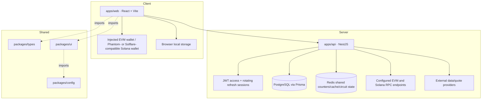

# Architecture

Mega Gods Prompt NEXT is a TypeScript npm-workspace monorepo. The web application, HTTP API, and shared packages remain separately built workspace units.

## Workspaces

| Path | Responsibility |
| --- | --- |
| `apps/web` | React/Vite interface, onboarding, wallet integration, panels for portfolio, screening, quotes, swaps, and SuperAdmin controls. Solana Web3 code is dynamically imported; several feature panels are lazy-loaded. |
| `apps/api` | NestJS API, validation, authentication/RBAC, Prisma persistence, Redis throttling/cache/circuits, RPC reads, provider integrations, auditing, health, and observability. |
| `packages/types` | Shared TypeScript types and the runtime user-role constant. |
| `packages/ui` | Shared React `GlassCard`, `FlashButton`, and `GlowBadge` components and exports. |
| `packages/config` | Shared theme-token exports consumed by UI code. |

The API applies the `/api` prefix, global DTO validation, CORS restricted to the configured web origin, rate limiting, geographic-access policy, JWT authentication, and role guards. `@Public()` routes opt out of JWT enforcement; health endpoints also skip throttling and geographic access. Role checks are hierarchical. See [`API.md`](API.md) for routes and [`OPERATIONS.md`](OPERATIONS.md) for runtime configuration.

## Data and transaction boundaries

- PostgreSQL stores users, hashed refresh sessions, swap order/execution state, financial and provider controls, and audit entries through Prisma.
- Redis provides shared production throttling and selected quote/screening caches and provider circuit state. Development may run without Redis and use in-memory throttling.
- Browser wallet providers perform wallet reads and request local approval/signing. The API never receives private keys. Solana signed swap transactions are relayed to Jupiter after wallet signing; EVM order transaction data is returned for the browser wallet to present, and the API later verifies settlement using its configured RPC.
- Portfolio aggregation accepts public wallet addresses for request-scoped RPC reads and does not persist the submitted addresses. EVM ERC-20 tokens and allowance pairs are manually tracked in account/network-scoped browser storage.
- Bridge quotes are sanitized estimates. There is no bridge transaction preparation, signing, execution, or persisted bridge-status workflow.

## Provider boundary

The repository uses 0x, 1inch, and ParaSwap for indicative EVM quotes, 0x for EVM swap execution, Jupiter for Solana swap execution and market data, LI.FI for bridge quotes, CoinGecko for portfolio pricing, GoPlus for token-screening indicators, and DEX Screener for Solana pool observations. Credentials, where required, are configured server-side. Availability and supported asset coverage remain subject to provider terms and service limits.

## Runtime checks

The API exposes public liveness and readiness checks at `/api/health/live` and `/api/health/ready`. Readiness checks PostgreSQL and the configured throttle storage. The API adds `X-Request-Id` and emits structured completion logs. Optional OTLP tracing instruments inbound HTTP spans; optional Sentry reporting filters unexpected errors. These integrations do not provide a full distributed trace of database or provider calls.
